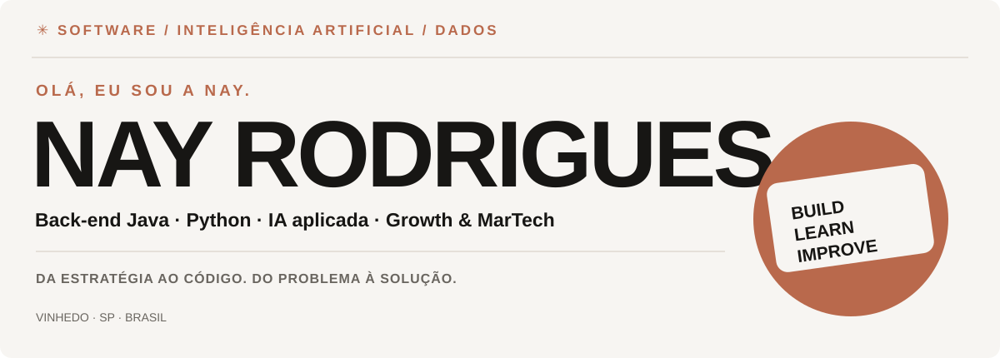

 

## Oi, eu sou a Nay.

Minha trajetória passa por **desenvolvimento back-end, Growth, MarTech e análise de dados**. Trabalhei com operações digitais, CRM, campanhas e equipes — e encontrei no desenvolvimento de software uma forma de ir além dos diagnósticos: construir ferramentas para resolver os problemas.

Estudei **Java, Spring Boot, APIs REST e SQL**, com formações complementares incluindo a GFT e a DIO. Hoje continuo aprofundando Java, Python e inteligência artificial aplicada. Quero criar soluções que façam sentido para quem usa, com uma base técnica sólida e olhar para o negócio.

> **Da estratégia ao código. Do problema à solução.**

**Atualmente:** estudante de **Análise e Desenvolvimento de Sistemas (Universidade Cruzeiro do Sul)**, **Marketing (UniBF)** e trajetória em **BTI / Engenharia da Computação (UNIVESP)** com situação da mudança de curso a confirmar

---

## Projetos selecionados

Reúno projetos de trabalho, estudos e produtos em fases diferentes, com separação entre o que está implementado e o que ainda está no roteiro

### Growth, dados e produto

| Projeto | Estado verificado | Acesso |
| :--- | :--- | :--- |
| **Optical Growth OS V2** | Protótipo local com dados fictícios, integração real a validar | [Case](https://nayjoplin.github.io/cases/optical-growth-os.html) |
| **Okan Nexus** | Repositório com código, execução ainda a validar | [Código](https://github.com/nayjoplin/okan-nexus-dash) |
| **Gerador de Currículos** | Repositório existente, funcionalidades a auditar | [Código](https://github.com/nayjoplin/gerador-de-curriculo) |
| **Growth Intelligence Platform** | Blueprint de 8 etapas, implementação planejada | [Plano](./portfolio-projects/growth-intelligence-platform/README.md) |

### Backend e engenharia de software

| Projeto | Origem e estado | Acesso |
| :--- | :--- | :--- |
| **Hospital Microservices** | Código existente em Java e Spring, execução a revisar, vínculo acadêmico não confirmado | [Código](https://github.com/nayjoplin/hospital-microservices2) |
| **Banco Digital POO** | Exercício do Santander + DIO com operações em Java | [Código](https://github.com/nayjoplin/banco-digital-poo-dio) |
| **Design Patterns Java** | Exercício Santander + DIO, padrões Singleton, Strategy e Facade | [Código](https://github.com/nayjoplin/explorando-design-patterns-java_) |
| **Digital Banking API** | Evolução autoral planejada do exercício original | [Plano](./portfolio-projects/digital-banking-api/README.md) |

### Inteligência artificial

| Projeto | Contexto | Acesso |
| :--- | :--- | :--- |
| **ResolveAI** | Projeto informado no currículo como TCC da Cruzeiro do Sul, em desenvolvimento | [Plano](./portfolio-projects/resolve-ai/README.md) |
| **DemandIQ** | Previsão de demanda, projeto autoral planejado | [Plano](./portfolio-projects/demandiq/README.md) |
| **SentinelAI** | Avaliação de qualidade de respostas de IA, projeto autoral planejado | [Plano](./portfolio-projects/sentinel-ai/README.md) |

[Ver todos os blueprints de 8 dias](./portfolio-projects/README.md) · [Portfólio online](https://nayjoplin.github.io/tech.html)

---

## Tecnologias e ferramentas

**Também trago do trabalho:** CRM, métricas de negócio, automação de processos, gestão de projetos digitais e experimentação com ferramentas de IA.

---

## O que minha experiência acrescenta ao código

| Desenvolvimento | Negócios & produto |
| :--- | :--- |
| Java, APIs REST, SQL, versionamento e testes | Diagnóstico de problemas, métricas e organização de processos |
| Projetos de back-end, dados e IA aplicada | Experiência com operações B2B/B2C, CRM e Growth |
| Aprendizado técnico contínuo e documentação | Liderança de equipe multidisciplinar e coordenação de projetos digitais |

Na minha trajetória em marketing e Growth, **coordenei uma equipe de aproximadamente 12 profissionais** e participei da gestão de **mais de 20 projetos digitais**. Minha meta é levar essa visão prática para a construção de software, não apenas para a estratégia.

---

## Formação & desenvolvimento

- **BTI / Engenharia da Computação** — UNIVESP · alteração de curso a confirmar
- **Análise e Desenvolvimento de Sistemas** — Universidade Cruzeiro do Sul · cursando
- **Marketing** — UniBF · cursando
- **Artes Visuais** — estudos na PUC-Campinas (2015–2018)

**Cursos e programas selecionados:** Java, Python, Angular e AWS (GFT Technology, 2026); Aspire Leaders Program (Aspire Institute, 2026); Desenvolvimento de Software (Grupo Boticário + Koru, 2025); Back-End com Java (Santander + DIO, 2025); Java Bootcamp (GFT + DIO, 2025).

**Estudando agora:** CS50’s Introduction to Programming with Python, Harvard University — *em andamento*.

**Idiomas:** português nativo · espanhol avançado · inglês básico a intermediário · italiano básico.

---

### Vamos conversar?

Se você está buscando alguém que conecte **engenharia de software, dados e visão de negócio**, conheça meus projetos e minha trajetória.

Vinhedo · São Paulo · Brasil — feito com atenção ao detalhe.

